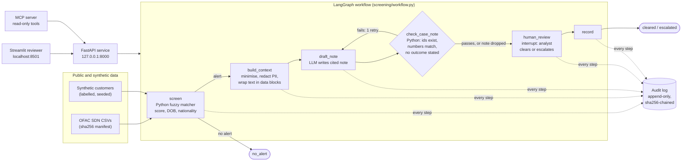

# Architecture

One screening run takes a (synthetic) customer from name matching to a human decision.
Code does every calculation and every check; the language model only writes a note;
the analyst is the only one who decides. Design reasons: [DECISIONS.md](DECISIONS.md).

## Who does what

| Step | Module | Done by | Can it decide the outcome? |
|---|---|---|---|
| Parse the OFAC list, keep it as published | `screening/ofac.py`, `scripts/download_ofac.py` | Python | No |
| Normalise names, score matches, compare DOB and nationality | `normalize.py`, `matching.py`, `dob.py` | Python (rapidfuzz) | No: raises alerts only |
| Build the only context a model sees (no customer id, DOB or nationality; PII redacted; free text escaped) | `context.py`, `redaction.py`, `untrusted.py` | Python | No |
| Draft a short note where every claim cites an evidence id | `case_note.py` via `llm.py` | LLM (Gemini or Claude) | No: the schema has no outcome or score field |
| Check every note (cited ids exist, numbers equal computed facts, no outcome stated as decided) | `case_note.py` | Python | No: drops a failing note after one retry |
| Clear or escalate, with a written reason | `workflow.py` (`human_review`) | Analyst | **Yes, only here** |
| Record every step with case ref, run id, list snapshot, prompt version and hash | `audit.py` | Python (SQLite triggers block edits) | No |

## Boundaries

- **One model adapter.** `screening/llm.py` is the only module that imports a model SDK
  (`StructuredLLM` protocol; `ClaudeLLM`, `GeminiLLM`). Tests use fakes from `tests/fakes.py`.
- **Demo vs live.** `SCREENING_MODE=demo` (default) replays notes recorded from a live
  Gemini run, keyed by the prompt's sha256 (`evaluation/cassettes/`), so the demo needs no key.
  Live mode needs a key from the gitignored `.env` and a `CASE_REF_SALT`.
- **Local only.** Both servers bind to localhost. No endpoint edits or deletes audit rows;
  the only way to close a case is the reviewer's decision. API responses never contain the
  customer id, DOB or raw documents.
- **State.** LangGraph checkpoints (SQLite, under `data/`, gitignored) let a paused case
  resume after a restart. The audit log is a separate SQLite file so checkpoints can be
  pruned without touching the record.
